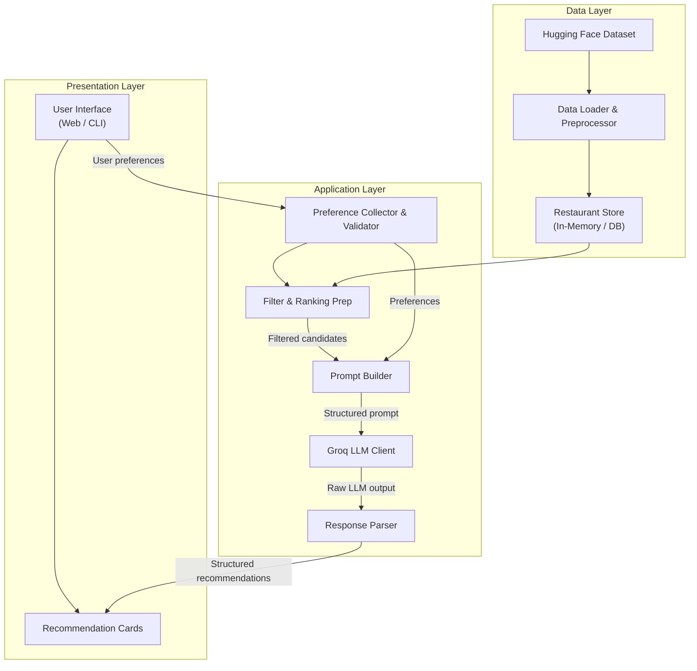
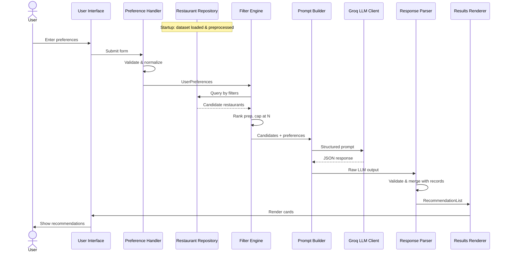
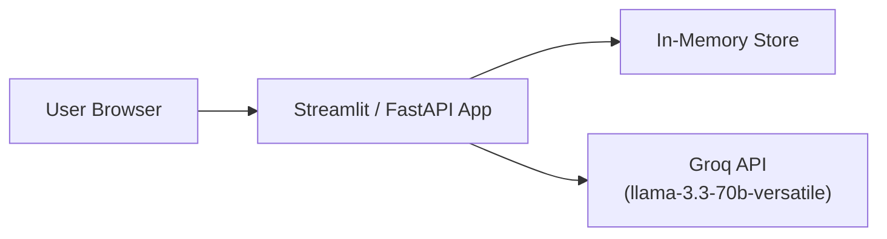

# Architecture: AI-Powered Restaurant Recommendation System

This document describes the technical architecture for the Zomato-inspired restaurant recommendation service defined in [context.md](./context.md). The system combines structured restaurant data with an LLM to deliver personalized, explainable recommendations.

---

## 1. Architecture Overview

The application follows a **layered, pipeline-based architecture** with five primary stages:

1. **Data Ingestion** — load and normalize the Zomato dataset
2. **User Input** — capture and validate preferences
3. **Integration Layer** — filter data and prepare LLM context
4. **Recommendation Engine** — rank and explain via LLM
5. **Output Display** — render results to the user

Each stage is loosely coupled so components can be developed, tested, and scaled independently.



---

## 2. Design Principles

| Principle | Description |
|-----------|-------------|
| **Separation of concerns** | Data loading, filtering, LLM orchestration, and UI are isolated modules |
| **Structured-first, LLM-second** | Hard filters reduce the candidate set before the LLM reasons over a manageable list |
| **Explainability** | Every recommendation includes an AI-generated rationale tied to user preferences |
| **Fail gracefully** | If the LLM is unavailable, return filtered results with rule-based ranking as fallback |
| **Config-driven** | Budget tiers, prompt templates, and model settings live in configuration, not code |

---

## 3. Component Architecture

### 3.1 Data Ingestion Layer

**Responsibility:** Fetch, clean, and persist restaurant records from the Hugging Face dataset.

| Component | Role |
|-----------|------|
| `DatasetLoader` | Downloads dataset via `datasets` library from [ManikaSaini/zomato-restaurant-recommendation](https://huggingface.co/datasets/ManikaSaini/zomato-restaurant-recommendation) |
| `Preprocessor` | Normalizes field names, parses cuisines, maps cost to budget tiers, handles missing values |
| `RestaurantRepository` | Abstracts read access to restaurant records (in-memory DataFrame, SQLite, or PostgreSQL) |

**Extracted fields (minimum):**

| Field | Type | Notes |
|-------|------|-------|
| `restaurant_name` | string | Display name |
| `location` / `city` | string | Used for location filter |
| `cuisines` | list[string] | May be comma-separated in raw data; split and normalize |
| `average_cost_for_two` | integer | Mapped to budget tier |
| `rating` | float | 0.0–5.0 scale |
| `address` | string | Optional, for display |
| `restaurant_id` | string/int | Unique identifier |

**Preprocessing steps:**

1. Load dataset split(s) from Hugging Face
2. Drop or impute rows with critical missing fields (name, location, rating)
3. Normalize city/location strings (trim, title-case, alias mapping e.g. `Bengaluru` → `Bangalore`)
4. Parse `cuisines` into a normalized list
5. Derive `budget_tier` from `average_cost_for_two`:

   | Tier | Cost for Two (INR) |
   |------|-------------------|
   | `low` | ≤ 500 |
   | `medium` | 501 – 1500 |
   | `high` | > 1500 |

6. Persist to `RestaurantRepository` for fast filtering at query time

**Startup behavior:** Data is loaded once at application startup (or via a dedicated ingestion script/cron). For development, an in-memory cache is sufficient; production may use a database with indexed columns on `location`, `cuisines`, and `budget_tier`.

---

### 3.2 User Input Layer

**Responsibility:** Collect, validate, and normalize user preferences.

| Component | Role |
|-----------|------|
| `PreferenceSchema` | Defines and validates input fields (Pydantic model or equivalent) |
| `PreferenceCollector` | UI form handler or CLI prompt reader |
| `PreferenceNormalizer` | Maps free-text inputs to canonical values |

**Input schema:**

```json
{
  "location": "Bangalore",
  "budget": "medium",
  "cuisine": "Italian",
  "min_rating": 4.0,
  "additional_preferences": "family-friendly, outdoor seating"
}
```

| Field | Required | Validation |
|-------|----------|------------|
| `location` | Yes | Must match a known city in the dataset (fuzzy match optional) |
| `budget` | Yes | Enum: `low`, `medium`, `high` |
| `cuisine` | No | String; partial match against cuisine list |
| `min_rating` | No | Float 0.0–5.0; default 0.0 |
| `additional_preferences` | No | Free-text; passed to LLM for semantic matching |

**Validation rules:**

- Reject empty `location`
- Clamp `min_rating` to [0.0, 5.0]
- Normalize `budget` to lowercase enum
- Trim and sanitize `additional_preferences` (max length cap to control prompt size)

---

### 3.3 Integration Layer

**Responsibility:** Bridge structured data and the LLM by filtering candidates and building a structured prompt.

| Component | Role |
|-----------|------|
| `FilterEngine` | Applies hard filters on the restaurant store |
| `CandidateSelector` | Limits results to top N candidates (e.g., 20–30) for LLM context window |
| `PromptBuilder` | Assembles system + user prompts with preferences and candidate JSON |
| `ContextManager` | Tracks token budget and truncates candidate list if needed |

**Filtering pipeline:**

```
All restaurants
    → filter by location (exact or case-insensitive match)
    → filter by budget_tier
    → filter by cuisine (contains match)
    → filter by min_rating
    → sort by rating descending
    → take top N candidates
    → pass to PromptBuilder
```

**Candidate selection strategy:**

1. Apply all hard filters sequentially
2. If fewer than 3 results, relax filters in order: cuisine → budget → min_rating (never relax location)
3. Cap at `MAX_CANDIDATES` (configurable, default 25) to stay within LLM token limits
4. Serialize candidates as compact JSON for the prompt

**Prompt design goals:**

- Provide the LLM with user preferences and a structured candidate list
- Instruct the model to rank, explain, and optionally summarize
- Request structured JSON output for reliable parsing

---

### 3.4 Recommendation Engine (Groq LLM Layer)

**Responsibility:** Use Groq-hosted LLMs to rank filtered restaurants and generate human-like explanations with low-latency inference.

| Component | Role |
|-----------|------|
| `LLMClient` | Wrapper around the Groq API (`groq` Python SDK) |
| `PromptTemplate` | Versioned prompt templates (system + user) |
| `ResponseParser` | Parses LLM JSON output into typed recommendation objects |
| `FallbackRanker` | Rule-based ranking when LLM call fails |

**LLM responsibilities:**

1. **Rank** — reorder candidates by fit to user preferences (not just rating)
2. **Explain** — 1–2 sentence rationale per restaurant referencing specific preferences
3. **Summarize** — optional brief overview of the recommendation set

**Recommended prompt structure:**

```
[System]
You are a restaurant recommendation assistant for Indian cities.
Given user preferences and a list of candidate restaurants, rank the top
recommendations and explain why each fits. Output valid JSON only.

[User]
Preferences:
- Location: {location}
- Budget: {budget}
- Cuisine: {cuisine}
- Minimum rating: {min_rating}
- Additional: {additional_preferences}

Candidates:
{candidates_json}

Return JSON:
{
  "summary": "...",
  "recommendations": [
    {
      "restaurant_id": "...",
      "rank": 1,
      "explanation": "..."
    }
  ]
}
```

**LLM configuration (Groq):**

| Setting | Recommended Value |
|---------|-------------------|
| Provider | [Groq](https://groq.com/) — fast inference for open-weight models |
| Model | `llama-3.3-70b-versatile` (default), or `llama-3.1-8b-instant` for lower latency |
| SDK | `groq` Python package |
| Temperature | 0.3 – 0.5 (balance creativity and consistency) |
| Max tokens | 1500 – 2000 |
| Response format | Request JSON output via prompt instructions; validate with `ResponseParser` |

**Fallback behavior:**

If the LLM call times out or returns invalid JSON:

1. Log the error
2. Return top 5 candidates ranked by `(rating DESC, cost proximity to budget tier)`
3. Attach a generic explanation: *"Recommended based on rating and your filters."*
4. Surface a non-blocking warning in the UI

---

### 3.5 Output Display Layer

**Responsibility:** Present recommendations in a clear, user-friendly format.

| Component | Role |
|-----------|------|
| `RecommendationFormatter` | Merges LLM output with full restaurant records |
| `ResultsRenderer` | Web UI component or CLI table output |
| `SummaryBlock` | Optional LLM-generated overview at the top |

**Output schema (per recommendation):**

| Field | Source |
|-------|--------|
| Restaurant Name | Dataset |
| Cuisine | Dataset |
| Rating | Dataset |
| Estimated Cost | Dataset (`average_cost_for_two`) |
| AI-generated Explanation | LLM |
| Rank | LLM |
| Address | Dataset (optional) |

**Example rendered output:**

```
┌─────────────────────────────────────────────────────────────┐
│  🍽️  Top Picks in Bangalore — Italian, Medium Budget        │
│  "Here are 3 great Italian spots that match your criteria…" │
├─────────────────────────────────────────────────────────────┤
│  #1  Truffles                           ⭐ 4.6  ₹₹₹         │
│      Italian, Continental                                   │
│      Perfect for a family dinner — high rating, mid-range   │
│      cost, and known for reliable service.                    │
├─────────────────────────────────────────────────────────────┤
│  #2  …                                                      │
└─────────────────────────────────────────────────────────────┘
```

---

## 4. Data Flow



---

## 5. Technology Stack (Recommended)

| Layer | Technology | Rationale |
|-------|-----------|-----------|
| Language | Python 3.10+ | Strong ecosystem for data + LLM integration |
| Dataset | `datasets` (Hugging Face) | Native loader for the Zomato dataset |
| Data processing | `pandas` | Filtering, transformation, in-memory queries |
| Validation | `pydantic` | Type-safe preference and response models |
| LLM SDK | `groq` | Official Groq client for chat completions |
| Web UI | `Streamlit` or `FastAPI` + React | Streamlit for rapid prototyping; FastAPI for production API |
| CLI | `typer` or `click` | Optional headless interface |
| Config | `.env` + `pydantic-settings` | API keys, model name, filter defaults |
| Testing | `pytest` | Unit tests for filter logic and prompt builder |

---

## 6. Project Structure

```
restaurant-recommender/
├── context.md
├── architecture.md
├── README.md
├── requirements.txt
├── .env.example              # GROQ_API_KEY, model settings
├── config/
│   ├── settings.py          # App configuration
│   └── prompts/
│       └── recommendation_v1.txt
├── data/
│   └── ingestion/
│       ├── loader.py        # Hugging Face dataset loader
│       └── preprocessor.py  # Cleaning & normalization
├── models/
│   ├── preferences.py       # UserPreference schema
│   └── recommendation.py    # Recommendation output schema
├── repositories/
│   └── restaurant_repo.py   # Data access abstraction
├── services/
│   ├── filter_engine.py     # Hard filtering logic
│   ├── prompt_builder.py    # LLM prompt assembly
│   ├── llm_client.py        # Groq API wrapper (chat completions)
│   ├── response_parser.py   # Parse & validate LLM JSON
│   └── recommender.py       # Orchestrates the full pipeline
├── ui/
│   ├── streamlit_app.py     # Web interface
│   └── cli.py               # Command-line interface
└── tests/
    ├── test_filter_engine.py
    ├── test_prompt_builder.py
    └── test_response_parser.py
```

---

## 7. API Design (Optional REST Layer)

If exposing the recommender as a service via FastAPI:

### `POST /api/v1/recommendations`

**Request:**

```json
{
  "location": "Delhi",
  "budget": "low",
  "cuisine": "Chinese",
  "min_rating": 3.5,
  "additional_preferences": "quick service"
}
```

**Response:**

```json
{
  "summary": "Found 3 Chinese restaurants in Delhi that fit your budget...",
  "recommendations": [
    {
      "rank": 1,
      "restaurant_name": "Wok Express",
      "cuisines": ["Chinese", "Asian"],
      "rating": 4.2,
      "estimated_cost_for_two": 400,
      "budget_tier": "low",
      "location": "Delhi",
      "explanation": "Highly rated for fast service and affordable pricing..."
    }
  ],
  "metadata": {
    "candidates_considered": 18,
    "filters_applied": ["location", "budget", "cuisine", "min_rating"],
    "llm_model": "llama-3.3-70b-versatile"
  }
}
```

### `GET /api/v1/health`

Returns service status and dataset load timestamp.

---

## 8. Configuration

| Variable | Description | Default |
|----------|-------------|---------|
| `HF_DATASET_NAME` | Hugging Face dataset ID | `ManikaSaini/zomato-restaurant-recommendation` |
| `LLM_PROVIDER` | LLM provider (fixed for this project) | `groq` |
| `LLM_MODEL` | Groq model identifier | `llama-3.3-70b-versatile` |
| `GROQ_API_KEY` | Groq API key | — |
| `MAX_CANDIDATES` | Max restaurants sent to LLM | `25` |
| `TOP_K_RESULTS` | Recommendations returned to user | `5` |
| `BUDGET_LOW_MAX` | Upper bound for low tier (INR) | `500` |
| `BUDGET_MEDIUM_MAX` | Upper bound for medium tier (INR) | `1500` |
| `LLM_TIMEOUT_SECONDS` | API call timeout | `30` |
| `ENABLE_FALLBACK_RANKER` | Use rule-based fallback on LLM failure | `true` |

---

## 9. Error Handling & Edge Cases

| Scenario | Handling |
|----------|----------|
| No restaurants match all filters | Relax filters progressively; inform user which filter was relaxed |
| Zero results after all relaxations | Return empty state with suggestion to broaden search |
| LLM timeout or invalid JSON | Activate `FallbackRanker`; show warning banner |
| Unknown location | Return validation error with list of supported cities |
| Dataset load failure | Fail startup with clear error; do not serve requests |
| Very long `additional_preferences` | Truncate to token-safe length before prompt assembly |

---

## 10. Security & Performance

**Security:**

- Store `GROQ_API_KEY` in environment variables, never in source code
- Sanitize all user inputs before embedding in prompts (prompt injection mitigation)
- Rate-limit API endpoints if exposed publicly

**Performance:**

- Load dataset once at startup; avoid per-request dataset downloads
- Index/filter in memory for datasets under ~100K rows
- Cache LLM responses keyed by `(preferences_hash, candidate_set_hash)` with TTL for identical queries
- Async Groq API calls if serving concurrent users via FastAPI
- Groq's fast inference keeps end-to-end recommendation latency low

---

## 11. Testing Strategy

| Test Type | Scope |
|-----------|-------|
| **Unit** | Filter engine, budget tier mapping, prompt builder, response parser |
| **Integration** | End-to-end pipeline with mocked LLM client |
| **Contract** | Validate LLM JSON output against `Recommendation` schema |
| **Snapshot** | Prompt template output for regression detection |

**Mock LLM in tests:** Return fixed JSON so tests do not depend on live API calls.

---

## 12. Deployment Options

| Environment | Approach |
|-------------|----------|
| **Local dev** | Streamlit app + in-memory data store |
| **Demo / hackathon** | Streamlit Cloud or Hugging Face Spaces |
| **Production** | FastAPI on Docker + PostgreSQL + reverse proxy |

**Minimal deployment diagram:**



---

## 13. Future Enhancements

- **Semantic search** — embed `additional_preferences` with vector similarity over restaurant descriptions
- **User history** — persist past searches to improve personalization
- **Multi-city support** — geolocation-based location detection
- **A/B prompt testing** — version and compare prompt templates
- **Observability** — log prompt/response pairs, latency, and filter hit rates
- **Feedback loop** — thumbs up/down on recommendations to refine ranking

---

## 14. Summary

The architecture separates **deterministic filtering** (fast, reliable, dataset-driven) from **probabilistic reasoning** (Groq LLM ranking and explanation). Hard filters narrow thousands of restaurants to a manageable candidate set; the Groq-powered LLM then applies nuanced preference matching and generates human-readable explanations. This hybrid approach balances accuracy, cost, latency, and explainability — the core requirements outlined in [context.md](./context.md).
