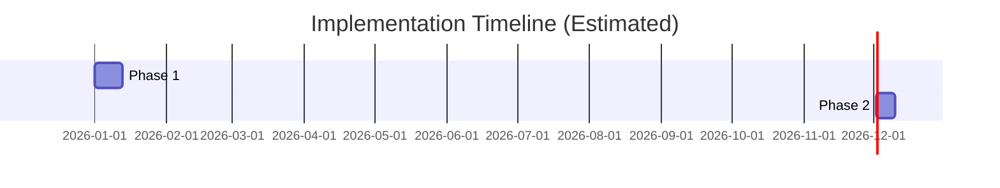

# Phase-Wise Implementation Plan

This document outlines the implementation plan for the AI-Powered Restaurant Recommendation System. To streamline development and ensure a robust API alongside a high-quality modern user interface, the project is divided into **two distinct phases**: **Phase 1 (Backend)** and **Phase 2 (Frontend)**.

---

## Overview

**Total estimated duration:** 3–4 weeks

---

## Phase 1: Backend Development

**Goal:** Build a robust, scalable Python API that handles data ingestion, filtering, and Groq LLM integration.

### Core Architecture & Setup
- Initialize Python project with `venv` and `requirements.txt` (`fastapi`, `uvicorn`, `datasets`, `groq`, `pydantic`).
- Create configuration management via `.env` for `GROQ_API_KEY` and other settings.

### 1. Data Ingestion Layer
- **DatasetLoader**: Load the Zomato dataset from Hugging Face (`datasets` library).
- **Preprocessor**: Clean data, normalize location strings, parse cuisines, and map budget tiers (`low`, `medium`, `high`).
- **Repository**: Implement `RestaurantRepository` for in-memory querying and filtering.

### 2. User Input & Integration Layer
- **Models**: Create typed Pydantic schemas (`UserPreference`) with strict validation (e.g., location required, rating constraints).
- **Filter Engine**: Apply sequential filtering (location → budget → cuisine → min_rating). Implement filter relaxation if results are too sparse.
- **Prompt Builder**: Format the filtered candidates safely within token limits (`MAX_CANDIDATES`) for the LLM prompt.

### 3. Groq LLM Engine
- **LLM Client**: Integrate the Groq SDK (`llama-3.3-70b-versatile`) to rank candidates and generate personalized explanations.
- **Fallback Mechanism**: Implement a rule-based `FallbackRanker` if the LLM API fails or times out.
- **Response Parser**: Extract and validate the JSON output from Groq.

### 4. API Layer & Hardening
- Expose the pipeline through a **FastAPI** REST interface (`POST /api/v1/recommendations`, `GET /api/v1/locations`).
- Implement comprehensive error handling (400 for bad inputs, 500 for server failures).
- Complete unit tests (Pytest) and ensure prompt injection safety.
- Optional: Containerize via Docker for deployment to Render/Railway.

### Phase 1 Deliverables
- A working REST API accessible via Swagger UI (FastAPI).
- Passing automated test suite.
- Backend deployment configuration.

---

## Phase 2: Frontend Development

**Goal:** Build a high-quality, modern web application (e.g., Next.js or React/Vite) with premium aesthetics and dynamic user flows.

### Core Architecture & Setup
- Initialize modern JavaScript/TypeScript framework.
- Configure tooling (Tailwind/CSS Modules, ESLint, Prettier).
- Establish a premium design system with custom typography, vibrant color palettes, and glassmorphism styling to avoid generic default looks.

### 1. UI Components & Layout
- **Base Components**: Build sleek inputs, custom dropdowns for location/budget, and premium buttons.
- **Layout**: Create a responsive Navbar, Footer, and Main Content layout that works beautifully across mobile and desktop.
- **Recommendation Card**: Design visually appealing cards showing restaurant name, cuisine, rating, estimated cost, and the AI-generated explanation.

### 2. API Integration & State Management
- Connect the frontend form to the FastAPI backend (`POST /api/v1/recommendations`).
- Manage application state and handle loading states smoothly (e.g., displaying premium skeleton loaders during Groq API latency).
- Handle edge cases gracefully: zero results, invalid locations, and backend fallback warnings.

### 3. Polish, Animations, & Hardening
- Implement micro-animations (hover effects on cards) and staggering entry animations for lists to create a dynamic feel.
- Ensure cross-browser compatibility and accessibility (ARIA labels, contrast checks).
- Perform end-to-end user flow testing.
- Optional: Deploy static/built assets to Vercel or Netlify.

### Phase 2 Deliverables
- A fully interactive, responsive web application.
- Seamless integration with the Backend API.
- Live public URL deployment.
